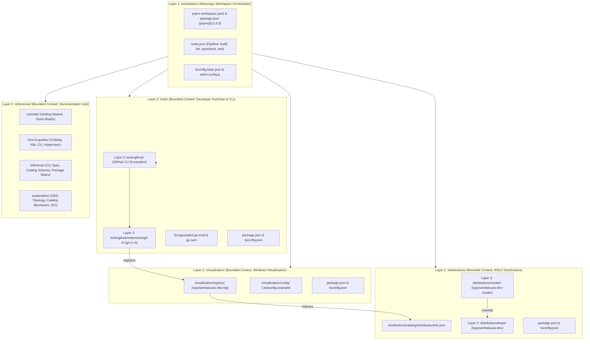

# Developer Workstation & CLI Monorepo (`tupynambalucas-dev/workstation`)

Sovereign enterprise monorepo hosting WSL2 Distribution-as-Code (`.wsl` Modern Distributions on Ubuntu 26.04 LTS), the `tl` / `gh tl` Go Developer CLI & GitHub CLI Extension suite, Windows Host virtualization governance, unified pnpm workspaces, and Turborepo task pipeline orchestration.

---

## 1. Architecture Overview

`workstation` consolidates developer environment provisioning, WSL2 operating system images, cryptographic SSH identity onboarding, and host hypervisor configuration into an enterprise monorepo governed by **Domain-Driven Design (DDD)**, **Feature-Sliced Design (FSD)**, **SOLID**, and **Clean Root** principles:



```text
workstation/
├── .github/actions/            # Scoped composite actions (setup-go-env, setup-pnpm-env)
├── .github/workflows/          # CI matrix validation (ci.yml) and release pipelines (release.yml)
├── distributions/              # Bounded Context: WSL2 Distribution-as-Code (Layer 2)
│   ├── package.json            # Workspace manifest (@tupynambalucas-dev/workstation-distributions)
│   ├── tsconfig.json           # TypeScript project reference
│   ├── src/index.ts            # Distribution exports & typing
│   ├── catalog/                # DistributionInfo.json corporate WSL2 catalog
│   ├── shared/                 # Shared OOBE provisioning and systemd masking scripts
│   ├── base/                   # tupynambalucas-dev daily developer workstation image (Layer 3)
│   └── cluster/                # tupynambalucas-dev-cluster Kubernetes engine image (Layer 3)
├── tools/                      # Bounded Context: Developer Toolchain & CLI (Layer 2)
│   ├── tsconfig.json           # Solution-style TypeScript reference for tools
│   └── github/                 # Layer 3: GitHub CLI Ecosystem & Extensions
│       └── extensions/
│           └── gh-tl/          # Standalone Go module & pnpm workspace package (@tupynambalucas-dev/workstation-gh-tl)
│               ├── go.mod & go.sum
│               ├── package.json
│               ├── tsconfig.json
│               ├── cmd/tl/     # CLI binary entrypoint (compiled by gh-extension-precompile)
│               ├── domains/    # FSD business domains (distro, host, onboard)
│               └── internal/   # Shared infrastructure adapters (contracts, git, github, ssh, wsl, ui)
├── virtualization/             # Bounded Context: Windows Host & Hypervisor Governance (Layer 2)
│   ├── package.json            # Workspace manifest (@tupynambalucas-dev/workstation-virtualization)
│   ├── tsconfig.json           # TypeScript project reference
│   ├── src/index.ts            # Virtualization domain exports
│   ├── config/                 # Authoritative .wslconfig.example template
│   ├── registry/               # tupynambalucas-dev.reg Windows Registry catalog federation
│   └── scripts/                # Host helper scripts (install.ps1 with deprecation notice)
├── references/                 # Bounded Context: Diataxis Documentation Hub (Layer 2)
│   ├── README.md               # Master documentation index and quadrant navigation
│   ├── AGENTS.md               # Documentation subsystem AI context router
│   ├── tutorials/              # Learning-oriented guides (Getting Started, Distro Builds)
│   ├── how-to-guides/          # Problem-oriented runbooks (Catalog, K8s, CLI, Hypervisor)
│   ├── reference/              # Information-oriented technical specs (CLI Spec, Schemas)
│   └── explanation/            # Understanding-oriented architecture rationale (DDD, OCI)
├── package.json                # Root Monorepo Orchestrator (@tupynambalucas-dev/workstation)
├── pnpm-workspace.yaml         # pnpm Workspaces configuration & strict catalogs
├── turbo.json                  # Turborepo task pipeline configuration
├── tsconfig.base.json          # Baseline TypeScript compiler options
├── tsconfig.json               # Solution-style root TypeScript project references
├── eslint.config.js            # Enterprise flat ESLint configuration
├── AGENTS.md                   # Layer-1 AI agent context router
├── LICENSE                     # Apache License 2.0 (Copyright (c) 2026 tupynambalucas.dev)
└── README.md                   # Primary repository documentation
```

---

## 2. Subsystems & Navigation

Subsystems are organized into autonomous enterprise Bounded Contexts conforming to the Domain-Driven Monorepo standard. Each Bounded Context maintains explicit architectural boundaries, ubiquitous language, and dedicated AI agent routers:

| Layer | Bounded Context / Workspace | Scope / Package | Documentation | Agent Context | Responsibilities |
| :-: | :--- | :--- | :--- | :--- | :--- |
| **2** | **`distributions/`** | `@tupynambalucas-dev/workstation-distributions` | [`distributions/README.md`](./distributions/README.md) | [`distributions/AGENTS.md`](./distributions/AGENTS.md) | Declarative WSL2 `.wsl` rootfs builds, `DistributionInfo.json` catalog, and shared OOBE/systemd scripts. |
| **3** | `distributions/base/` | Sub-package | [`distributions/base/README.md`](./distributions/base/README.md) | [`distributions/base/AGENTS.md`](./distributions/base/AGENTS.md) | `tupynambalucas-dev`: Ubuntu 26.04 LTS daily developer workstation (`node` 22, `pnpm` 12, `go` 1.27, `gh`, `mani`, `infisical`, socket-activated Docker). |
| **3** | `distributions/cluster/` | Sub-package | [`distributions/cluster/README.md`](./distributions/cluster/README.md) | [`distributions/cluster/AGENTS.md`](./distributions/cluster/AGENTS.md) | `tupynambalucas-dev-cluster`: Ubuntu 26.04 LTS Kubernetes engine (`docker-ce`, `k3d`, `kubectl`, `helm`, `skaffold`, `kubeseal`, kernel `sysctl` tuning). |
| **2** | **`tools/`** | Workspace Solution | [`tools/README.md`](./tools/README.md) | [`tools/AGENTS.md`](./tools/AGENTS.md) | Developer toolchain workspace and multi-extension orchestration. |
| **3** | `tools/github/` | Toolchain Ecosystem | [`tools/github/README.md`](./tools/github/README.md) | [`tools/github/AGENTS.md`](./tools/github/AGENTS.md) | GitHub CLI ecosystem and extension modules. |
| **3** | `tools/github/extensions/gh-tl/` | `@tupynambalucas-dev/workstation-gh-tl` | [`tools/github/extensions/gh-tl/README.md`](./tools/github/extensions/gh-tl/README.md) | [`tools/github/extensions/gh-tl/AGENTS.md`](./tools/github/extensions/gh-tl/AGENTS.md) | Multi-platform Go CLI (`gh tl` / `tl`): cryptographic onboarding, host readiness, and WSL distribution lifecycle. |
| **2** | **`virtualization/`** | `@tupynambalucas-dev/workstation-virtualization` | [`virtualization/README.md`](./virtualization/README.md) | [`virtualization/AGENTS.md`](./virtualization/AGENTS.md) | Windows Registry catalog injection (`tupynambalucas-dev.reg`), `.wslconfig.example` (`sparseVhd=true`), and hypervisor memory bounds. |
| **2** | **`references/`** | Documentation Hub | [`references/README.md`](./references/README.md) | [`references/AGENTS.md`](./references/AGENTS.md) | Diataxis-structured technical documentation hub (tutorials, how-to-guides, technical reference, architecture explanation). |

> [!NOTE]
> For master technical plans, universal Go host readiness, and domain-driven refactoring blueprints, see the [Modern Distribution & Universal CLI Architecture Suite](./.agents/plans/distro-distribution-and-cli-architecture/README.md).

---

## 3. Environment & Identity Governance

1. **Zero-Key Duplication Across WSL2 & Windows Host**:
   Both `tupynambalucas-dev` and `tupynambalucas-dev-cluster` WSL2 distributions automatically configure the `tupy` (`uid=1000`) developer account and bridge the Windows host's `~/.ssh` keys and `~/.gitconfig-tupynambalucas-dev` on first boot via OOBE provisioning.
2. **Cryptographic Onboarding (`gh tl onboard`)**:
   Generates deterministic Ed25519 SSH authentication and signing keys, registers them with GitHub via authenticated `gh` sessions, configures `gpg.format = ssh`, and verifies all 7 workstation readiness gates (`gh tl verify`).
3. **Hypervisor Resource Isolation**:
   Copy [`virtualization/config/.wslconfig.example`](./virtualization/config/.wslconfig.example) to `%USERPROFILE%\.wslconfig` to enable `sparseVhd=true`, mirrored networking, and bounded memory allocation.

---

## 4. Getting Started

### 4.1. Prerequisites

- Windows 11 Build 22621+ with WSL 2.4.4+ or 3.0+.
- [GitHub CLI (`gh`)](https://cli.github.com/) authenticated via `gh auth login`.
- Node.js 22+ and `pnpm` 12+ (or Corepack).

### 4.2. Developer Installation (Automated via GitHub CLI)

```powershell
# 1. Install the official precompiled workstation extension
gh extension install tupynambalucas-dev/workstation

# 2. Execute Day-0 cryptographic onboarding
gh tl onboard

# 3. Prepare Windows host registry and hypervisor configuration
gh tl host prepare

# 4. Stream and install the daily developer workstation
gh tl distro install tupynambalucas-dev
```

---

## 5. Development & Pipeline Scripts

Task execution across all bounded contexts is powered by Turborepo and pnpm workspaces:

```bash
# Install workspace dependencies via strict catalogs
pnpm install

# Run static analysis across all workspaces
pnpm lint

# Run TypeScript typechecks across all workspaces
pnpm typecheck

# Run tests across all workspaces (invokes go test via Turborepo)
pnpm test

# Build all packages and CLI binaries
pnpm build
```

---

## 6. Governance & Contributing Standards

- **Branching Model**: Single-Branch GitHub Flow on `main`. Feature branches must follow Conventional Commit naming (`feat/<slug>`, `fix/<slug>`, `docs/<slug>`, `chore/<slug>`).
- **Cryptographic Signatures**: All Git commits and annotated tags MUST be signed using SSH: `git commit -S -m "..."`.
- **Conventional Commits**: Commit messages must adhere strictly to Conventional Commits v1.0.0 (`<type>(<scope>): <description>`).
- **Zero-Emoji Policy**: Emojis are strictly forbidden across code, commits, PRs, and documentation.
- **Language Standard**: Code, documentation, and configuration must be written strictly in `en-US`.
- **Agent Context Router**: AI agents operating in this repository MUST inspect and comply with [`AGENTS.md`](./AGENTS.md).

---

## 7. License

Licensed under the Apache License, Version 2.0 (the "License"); you may not use this file except in compliance with the License. You may obtain a copy of the License at:

[Apache License 2.0](./LICENSE)

Copyright (c) 2026 tupynambalucas.dev.
