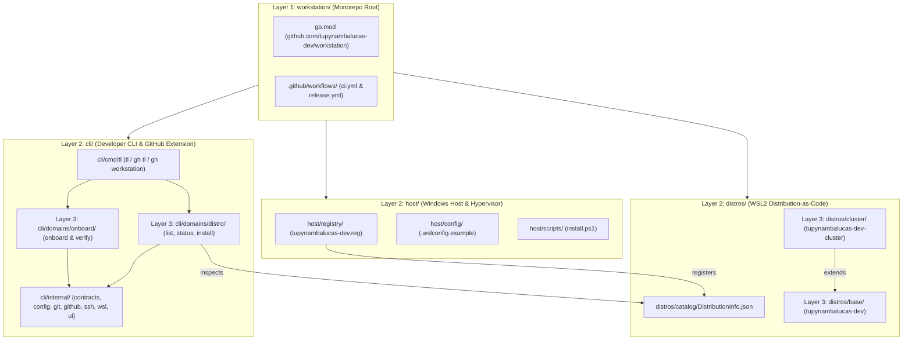

# Developer Workstation & CLI Monorepo (`tupynambalucas-dev/workstation`)

Sovereign bounded-context monorepo for developer workstation engineering, WSL2 Distribution-as-Code (`.wsl` Modern Distributions on Ubuntu 26.04 LTS), the `tl` / `gh tl` Go Developer CLI & GitHub CLI Extension suite, and Windows Host virtualization governance.

---

## 1. Architecture Overview

`workstation` consolidates developer environment provisioning, WSL2 operating system images, cryptographic SSH identity onboarding, and host hypervisor configuration into a single source of truth governed by **Domain-Driven Design (DDD)**, **Feature-Sliced Design (FSD)**, **SOLID**, and **Single Source of Truth (SSOT)** principles:



```text
workstation/
├── .github/workflows/       # CI validation (ci.yml) and multi-platform release pipelines (release.yml)
├── cli/                     # Multi-platform Go CLI suite (tl / gh tl) and domain adapters (Layer 2)
│   ├── cmd/tl/              # CLI binary entrypoint
│   ├── domains/distro/      # WSL2 catalog discovery and SHA-256 installation domain (Layer 3)
│   ├── domains/onboard/     # Cryptographic SSH signing onboarding and 7 readiness gates (Layer 3)
│   └── internal/            # Shared infrastructure contracts and OS/GitHub/WSL adapters
├── distros/                 # Declarative WSL2 Distribution-as-Code (Layer 2)
│   ├── catalog/             # DistributionInfo.json corporate WSL2 catalog
│   ├── shared/              # Shared OOBE provisioning and systemd initialization scripts
│   ├── base/                # tupynambalucas-dev daily developer workstation image (Layer 3)
│   └── cluster/             # tupynambalucas-dev-cluster Kubernetes engine image (Layer 3)
├── host/                    # Windows 11 host registry catalog, .wslconfig.example, and Day-0 installer (Layer 2)
├── AGENTS.md                # Sovereign Layer-1 AI agent context router
├── go.mod                   # Root Go module manifest (github.com/tupynambalucas-dev/workstation)
├── LICENSE                  # Apache License 2.0
└── README.md                # Primary developer documentation
```

---

## 2. Subsystems & Navigation

| Layer | Subsystem / Workspace | Documentation | Agent Context | Responsibilities |
| :-: | :--- | :--- | :--- | :--- |
| **2** | **`distros/`** | [`distros/README.md`](./distros/README.md) | [`distros/AGENTS.md`](./distros/AGENTS.md) | Declarative WSL2 `.wsl` rootfs builds, `DistributionInfo.json` catalog, and shared OOBE/systemd scripts. |
| **3** | **`distros/base/`** | [`distros/base/README.md`](./distros/base/README.md) | [`distros/base/AGENTS.md`](./distros/base/AGENTS.md) | `tupynambalucas-dev`: Ubuntu 26.04 LTS daily developer workstation (`node` 22, `pnpm` 12, `go` 1.27, `gh`, `mani`, `infisical`, socket-activated Docker). |
| **3** | **`distros/cluster/`** | [`distros/cluster/README.md`](./distros/cluster/README.md) | [`distros/cluster/AGENTS.md`](./distros/cluster/AGENTS.md) | `tupynambalucas-dev-cluster`: Ubuntu 26.04 LTS Kubernetes engine (`docker-ce`, `k3d`, `kubectl`, `helm`, `skaffold`, `kubeseal`, kernel `sysctl` tuning). |
| **2** | **`cli/`** | [`cli/README.md`](./cli/README.md) | [`cli/AGENTS.md`](./cli/AGENTS.md) | Multi-platform Go CLI suite (`tl` / `gh tl`) and shared infrastructure adapters (`cli/internal/*`). |
| **3** | **`cli/domains/onboard/`** | [`cli/domains/onboard/README.md`](./cli/domains/onboard/README.md) | [`cli/domains/onboard/AGENTS.md`](./cli/domains/onboard/AGENTS.md) | Automated Ed25519 SSH signing setup, GitHub API key registration, conditional Git `includeIf`, and 7 readiness gates (`tl onboard` & `tl verify`). |
| **3** | **`cli/domains/distro/`** | [`cli/domains/distro/README.md`](./cli/domains/distro/README.md) | [`cli/domains/distro/AGENTS.md`](./cli/domains/distro/AGENTS.md) | WSL2 catalog discovery, host inspection, and SHA-256 verified installation (`tl distro list\|status\|install`). |
| **2** | **`host/`** | [`host/README.md`](./host/README.md) | [`host/AGENTS.md`](./host/AGENTS.md) | Windows Registry catalog injection (`tupynambalucas-dev.reg`), `.wslconfig.example` (`sparseVhd=true`), and Day-0 `install.ps1`. |

---

## 3. Environment & Identity Governance

1. **Zero-Key Duplication Across WSL2 & Windows Host**:
   Both `tupynambalucas-dev` and `tupynambalucas-dev-cluster` WSL2 distributions automatically configure the `tupy` (`uid=1000`) developer account and bridge the Windows host's `~/.ssh` keys and `~/.gitconfig-tupynambalucas-dev` on first boot via OOBE provisioning.
2. **Cryptographic Onboarding (`gh tl onboard`)**:
   Generates deterministic Ed25519 SSH authentication and signing keys, registers them with GitHub via authenticated `gh` sessions, configures `gpg.format = ssh`, and verifies all 7 workstation readiness gates (`gh tl verify`).
3. **Hypervisor Resource Isolation**:
   Copy [`host/config/.wslconfig.example`](./host/config/.wslconfig.example) to `%USERPROFILE%\.wslconfig` to enable `sparseVhd=true`, mirrored networking, and bounded memory allocation.

---

## 4. Getting Started

### Prerequisites

- **Windows 11 Host**: WSL `>= 2.4.4` (for native `.wsl` Modern Distribution support)
- **Go Toolchain**: `>= 1.24` (when building the `tl` CLI from source)
- **GitHub CLI (`gh`)**: `>= 2.60` (for `gh extension install`)

### Installation & Quick Start

#### A. Native WSL2 Distribution Installation

Register the corporate distribution catalog once via [`host/registry/tupynambalucas-dev.reg`](./host/registry/tupynambalucas-dev.reg) (or [`host/scripts/install.ps1`](./host/scripts/install.ps1)), then invoke native `wsl.exe`:

```powershell
# List corporate distributions alongside official Microsoft distributions
wsl --list --online

# Install the daily developer workstation
wsl --install tupynambalucas-dev

# Install the isolated Kubernetes cluster engine
wsl --install tupynambalucas-dev-cluster
```

#### B. Developer CLI & GitHub CLI Extension (`tl` / `gh tl`)

```bash
# Install as a precompiled GitHub CLI extension
gh extension install tupynambalucas-dev/workstation

# Execute workstation readiness verification or full interactive onboarding
gh tl verify
gh tl onboard

# Inspect and manage corporate WSL2 distributions
gh tl distro list
gh tl distro status
```

---

## 5. Development & Pipeline Scripts

| Command | Target Scope | Description |
| :--- | :--- | :--- |
| `go vet ./cli/...` | `cli/` | Runs Go static analysis across all CLI packages and domains. |
| `go test -v ./cli/...` | `cli/` | Executes unit and contract test suites across `cli/`. |
| `go build -o dist/tl ./cli/cmd/tl` | `cli/` | Compiles the standalone `tl` CLI binary into `dist/tl`. |
| `jq empty distros/catalog/DistributionInfo.json` | `distros/catalog/` | Validates the WSL2 modern distribution catalog JSON syntax. |
| `jq empty distros/base/assets/terminal-profile.json` | `distros/base/` | Validates the base workstation Windows Terminal profile fragment. |
| `jq empty distros/cluster/assets/terminal-profile.json` | `distros/cluster/` | Validates the cluster workstation Windows Terminal profile fragment. |

---

## 6. Governance & Contributing Standards

1. **Cryptographic Commit Signing**: All Git commits and annotated tags MUST be signed using SSH (`git commit -S -m "..."`).
2. **Conventional Commits**: All commit messages MUST conform to Conventional Commits v1.0.0 (`<type>(<scope>): <description>`).
3. **Single-Branch GitHub Flow**: Short-lived branches (`feat/<slug>`, `fix/<slug>`, `docs/<slug>`, `chore/<slug>`) branch off `main` and merge via Pull Request.
4. **Zero-Emoji Invariant**: Emojis are strictly prohibited across Go source code, shell scripts, documentation, commit messages, and CLI output.
5. **Secret Hygiene**: Never commit private SSH keys, tokens, or `.env` files.
6. **AI Agent Context**: Autonomous agents operating in this repository MUST read [AGENTS.md](./AGENTS.md) and the target bounded context's local `AGENTS.md` before modifying files.

---

## 7. License

Licensed under the [Apache License 2.0](./LICENSE). Copyright (c) 2026 tupynambalucas.dev.
