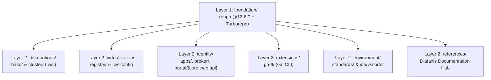

# Enterprise Foundation & Identity Monorepo (`@tupynambalucas-dev/foundation`)

Sovereign enterprise monorepo hosting WSL2 Distribution-as-Code (`.wsl` Modern Distributions on Ubuntu 26.04 LTS), the `tl` / `gh tl` Go Developer CLI extension, 4-Tier GitHub App machine identities, Go Token Broker, Cloudflare Workers Identity Portal (`apps.tupynambalucas.dev`), Windows host virtualization governance, and developer environment standards.

---

## 1. Architecture Overview

`foundation` consolidates developer workstation provisioning, WSL2 operating system images, cryptographic machine identities, Token Broker STS, and edge identity services into a single pnpm/Turborepo monorepo governed by **Domain-Driven Design (DDD)**, **Feature-Sliced Design (FSD)**, **SOLID**, and **Clean Root** principles:



```text
foundation/
├── .github/                    # Composite actions, CI, CodeQL, deploy-portal.yml, app-lifecycle-sync.yml
├── distributions/              # Layer 2: WSL2 Distribution-as-Code (base/, cluster/, catalog/, shared/)
├── virtualization/             # Layer 2: Windows Host Registry federation & .wslconfig governance
├── identity/                   # Layer 2: Sovereign Machine Identities, Token Broker & Cloudflare Portal
│   ├── apps/                   # Declarative 4-Tier GitHub App manifests & Google Cloud identity metadata
│   ├── compliance/             # Corporate Privacy Policy & Terms of Service
│   ├── broker/                 # Layer 3: Go Token Broker STS (go.mod, policies.yaml)
│   └── portal/                 # Grouping folder for modular Cloudflare Identity Portal
│       ├── core/               # Layer 3: @tupynambalucas-dev/identity-portal-core
│       ├── web/                # Layer 3: @tupynambalucas-dev/identity-portal-web (React 19 + Vite + FSD)
│       └── api/                # Layer 3: @tupynambalucas-dev/identity-portal-api (Cloudflare Worker + Workflows)
├── extensions/                 # Layer 2: Developer CLI Extensions (gh-tl/ Go module)
├── environment/                # Layer 2: Editor standards & IDE profiles (ide/vscode/)
├── references/                 # Layer 2: Diataxis technical documentation hub
├── package.json                # Root Monorepo Orchestrator (@tupynambalucas-dev/foundation)
├── pnpm-workspace.yaml         # pnpm workspaces & strict catalogs
├── turbo.json                  # Turborepo task pipeline configuration
├── AGENTS.md                   # Layer 1 AI agent context router
└── LICENSE                     # Apache License 2.0
```

---

## 2. Subsystems & Navigation

Subsystems are organized into autonomous enterprise Bounded Contexts conforming to the Domain-Driven Monorepo standard. Each Bounded Context maintains explicit architectural boundaries, ubiquitous language, and dedicated AI agent routers:

| Layer | Bounded Context / Workspace | Scope / Package | Documentation | Agent Context | Responsibilities |
| :-: | :--- | :--- | :--- | :--- | :--- |
| **2** | **`distributions/`** | `@tupynambalucas-dev/workstation-distributions` | [`distributions/README.md`](./distributions/README.md) | [`distributions/AGENTS.md`](./distributions/AGENTS.md) | Declarative WSL2 `.wsl` rootfs builds, `DistributionInfo.json` catalog, and shared OOBE/systemd scripts. |
| **3** | `distributions/base/` | Sub-package | [`distributions/base/README.md`](./distributions/base/README.md) | [`distributions/base/AGENTS.md`](./distributions/base/AGENTS.md) | `tupynambalucas-dev`: Ubuntu 26.04 LTS daily workstation with socket-activated Docker. |
| **3** | `distributions/cluster/` | Sub-package | [`distributions/cluster/README.md`](./distributions/cluster/README.md) | [`distributions/cluster/AGENTS.md`](./distributions/cluster/AGENTS.md) | `tupynambalucas-dev-cluster`: Ubuntu 26.04 LTS Kubernetes engine (`k3d`, `kubectl`, `helm`, `sysctl`). |
| **2** | **`virtualization/`** | `@tupynambalucas-dev/workstation-virtualization` | [`virtualization/README.md`](./virtualization/README.md) | [`virtualization/AGENTS.md`](./virtualization/AGENTS.md) | Windows Registry catalog injection (`tupynambalucas-dev.reg`) and `.wslconfig.example` hypervisor bounds. |
| **2** | **`identity/`** | Bounded Context | [`identity/README.md`](./identity/README.md) | [`identity/AGENTS.md`](./identity/AGENTS.md) | 4-Tier GitHub App manifests, Google Cloud identities, compliance pages, Token Broker, and `apps.tupynambalucas.dev`. |
| **3** | `identity/broker/` | Go Module (`identity/broker`) | [`identity/broker/README.md`](./identity/broker/README.md) | [`identity/broker/AGENTS.md`](./identity/broker/AGENTS.md) | Go STS vending 60-minute down-scoped Installation Access Tokens with OIDC JWKS and 55m caching. |
| **3** | `identity/portal/core/` | `@tupynambalucas-dev/identity-portal-core` | [`identity/portal/core/README.md`](./identity/portal/core/README.md) | [`identity/portal/core/AGENTS.md`](./identity/portal/core/AGENTS.md) | Zero-dependency shared TypeScript contracts, live app status types, and canonical route constants. |
| **3** | `identity/portal/web/` | `@tupynambalucas-dev/identity-portal-web` | [`identity/portal/web/README.md`](./identity/portal/web/README.md) | [`identity/portal/web/AGENTS.md`](./identity/portal/web/AGENTS.md) | React 19 + Vite + Tailwind FSD SPA with live `/api/apps/status` hydration. |
| **3** | `identity/portal/api/` | `@tupynambalucas-dev/identity-portal-api` | [`identity/portal/api/README.md`](./identity/portal/api/README.md) | [`identity/portal/api/AGENTS.md`](./identity/portal/api/AGENTS.md) | Cloudflare Worker (`tupynambalucas-apps-portal`), `PrGateEvaluatorWorkflow`, Zero Trust Manifest Flow, and Infisical callback. |
| **2** | **`extensions/`** | Bounded Context | [`extensions/README.md`](./extensions/README.md) | [`extensions/AGENTS.md`](./extensions/AGENTS.md) | Sovereign developer CLI extensions and workflow accelerators. |
| **3** | `extensions/gh-tl/` | `@tupynambalucas-dev/workstation-gh-tl` | [`extensions/gh-tl/README.md`](./extensions/gh-tl/README.md) | [`extensions/gh-tl/AGENTS.md`](./extensions/gh-tl/AGENTS.md) | Multi-platform Go CLI (`gh tl` / `tl`): cryptographic onboarding, host readiness, and WSL lifecycle. |
| **2** | **`environment/`** | `@tupynambalucas-dev/foundation-environment` | [`environment/README.md`](./environment/README.md) | [`environment/AGENTS.md`](./environment/AGENTS.md) | Universal editor standards, formatting specifications, and IDE workspace profiles. |
| **3** | `environment/ide/vscode/` | Sub-package | [`environment/ide/vscode/README.md`](./environment/ide/vscode/README.md) | [`environment/ide/vscode/AGENTS.md`](./environment/ide/vscode/AGENTS.md) | Enterprise VS Code profiles, extension compatibility matrices, and keybindings. |
| **2** | **`references/`** | Documentation Hub | [`references/README.md`](./references/README.md) | [`references/AGENTS.md`](./references/AGENTS.md) | Diataxis-structured technical documentation hub (`tutorials/`, `how-to-guides/`, `reference/`, `explanation/`). |

---

## 3. Environment & Secret Governance

1. **Zero-Disk-PEM Machine Identity Vaulting**: GitHub App RSA private keys are minted via the Zero Trust serverless Manifest Flow (`https://apps.tupynambalucas.dev/api/github/provision`) and stored directly in Infisical Cloud (`/governance`, `/delivery`, `/protection`, `/workstation`).
2. **Zero-Key Duplication Across WSL2 & Windows Host**: WSL2 distributions bridge the Windows host's `~/.ssh` keys and `~/.gitconfig-tupynambalucas-dev` on first boot via OOBE provisioning.
3. **Cryptographic Onboarding (`gh tl onboard`)**: Generates deterministic Ed25519 SSH authentication/signing keys, configures `gpg.format = ssh`, and verifies workstation readiness (`gh tl verify`).

---

## 4. Getting Started

### 4.1. Prerequisites

- Windows 11 Build 22621+ with WSL 2.4.4+ (for WSL2 distributions and virtualization).
- [GitHub CLI (`gh`)](https://cli.github.com/) authenticated via `gh auth login`.
- Node.js 22+, `pnpm` 12.6+, and Go 1.24+.

### 4.2. Installation

```bash
pnpm install
pnpm build
pnpm test
```

---

## 5. Development & Pipeline Scripts

| Command | Description |
| :--- | :--- |
| `pnpm build` | Builds all TypeScript, Vite, and Go workspace packages via Turborepo. |
| `pnpm typecheck` | Executes project-referenced TypeScript typechecking across all workspaces. |
| `pnpm test` | Runs unit tests across all workspaces (Cloudflare Portal API and Go CLI). |
| `pnpm lint` | Executes flat ESLint static analysis across all workspaces. |
| `pnpm format:check` | Verifies Prettier formatting compliance. |
| `pnpm tl:build` / `pnpm tl:test` | Builds and tests `@tupynambalucas-dev/workstation-gh-tl`. |

---

## 6. Governance & Contributing Standards

- **Branching Model**: Single-Branch GitHub Flow on `main` using Conventional Commit branch prefixes (`feat/`, `fix/`, `docs/`, `chore/`, `refactor/`).
- **Cryptographic Signatures**: All Git commits and annotated tags MUST be signed with SSH: `git commit -S -m "..."`.
- **Conventional Commits**: Commit messages MUST adhere strictly to Conventional Commits v1.0.0 (`<type>(<scope>): <description>`).
- **Zero-Emoji Policy**: Emojis are strictly forbidden across code, commits, PRs, and documentation.
- **Language Standard**: Code, documentation, and configuration MUST be written strictly in `en-US`.
- **Agent Context Router**: AI agents operating in this repository MUST read and comply with [`AGENTS.md`](./AGENTS.md).

---

## 7. License

Licensed under the Apache License, Version 2.0. See [Apache License 2.0](./LICENSE).

Copyright (c) 2026 tupynambalucas.dev.
