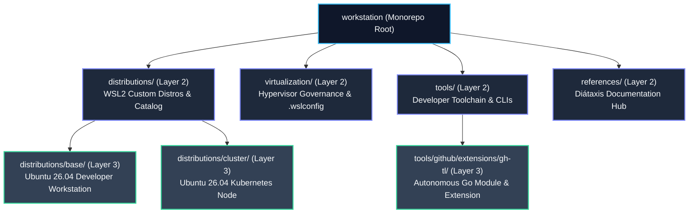

# Workstation Architecture and DDD Topology

Architectural rationale and design principles behind structuring `tupynambalucas-dev/workstation` as a domain-driven monorepo with clean root invariants, pnpm workspace orchestration, and encapsulated Go toolchains.

---

## 1. Context & Motivation

Historically, workstation repositories combined root-level Go CLI code, Dockerfiles, and PowerShell scripts in a flat structure. This caused several severe architectural problems:
1. **Polluted Monorepo Root**: Having `go.mod`, `go.sum`, and root Go files mixed with monorepo orchestration assets caused tooling confusion and violated clean root principles.
2. **Coupled Lifecycles**: A change to a distribution Dockerfile would unnecessarily trigger Go CLI compilation or lint checks, and vice versa.
3. **Inconsistent Naming**: Folder names like `distros/` and `host/` deviated from the enterprise Domain-Driven Design (DDD) naming standard established in `docs/apps/portal/.../bounded-contexts.mdx`.
4. **Lack of Standard Monorepo Tooling**: Without pnpm workspaces and Turborepo, quality gates (linting, typechecking, formatting) had to be invoked with disparate ad-hoc commands.

---

## 2. The 3-Tier DDD Bounded Context Architecture

To establish clean boundaries, `workstation` was refactored into three autonomous Layer-2 bounded contexts, coordinated by a clean monorepo root:

### The 3 Bounded Contexts:

1. **`distributions/`**: Houses WSL2 distribution recipes (Dockerfiles), OOBE lifecycle scripts, systemd masking definitions, and the canonical `DistributionInfo.json` catalog.
2. **`virtualization/`**: Governs Windows host hypervisor configuration (`.wslconfig`), Windows Terminal profile fragment assets, and Win32 registry files.
3. **`tools/`**: Houses developer toolchains, CLI extensions, and automation utilities. Modeled after `platform/tools`, it encapsulates GitHub CLI extensions under `tools/github/extensions/gh-tl/`.

---

## 3. The Clean Root Invariant

Under the Clean Root Invariant:
- The monorepo root contains strictly zero single-language CLI manifests (`go.mod`, `go.sum`).
- All Go code, dependencies, and build logic reside encapsulated within `tools/github/extensions/gh-tl/`.
- The root `package.json` and `pnpm-workspace.yaml` govern repository-wide TypeScript, linting, formatting, and Turborepo pipelines.

### Benefits of Clean Root:
- Multi-root IDE workspaces (`tupynambalucas-dev-core.code-workspace`) parse language servers without root-level Go SDK interference.
- GitHub Actions workflows use granular path triggers, preventing cross-domain build thrashing.
- New CLI tools or extensions (e.g., written in Rust, TypeScript, or Go) can be introduced under `tools/` without mutating root configuration.

---

## 4. Modern Monorepo Orchestration with pnpm and Turborepo

Modeled after `tupynambalucas-dev/platform`, `workstation` implements:
1. **Strict pnpm Catalogs**: Centrally manages dependencies (`catalog:tooling-stack`, `catalog:`) to ensure 100% version lock across workspaces.
2. **TypeScript Project References**: Solution-style `tsconfig.json` (`"files": []`, `"references": [...]`) guarantees sub-second incremental typechecking across packages.
3. **Turborepo Pipelines**: Orchestrates `build`, `lint`, `typecheck`, and `test` with cached artifact hashing, accelerating local verification and CI pipelines.

---

## Related References

- [Repository Anatomy and Package Matrix](../reference/repository-anatomy-and-package-matrix.md)
- [Modern WSL Catalog vs Legacy Distros](./modern-wsl-catalog-vs-legacy-distros.md)
